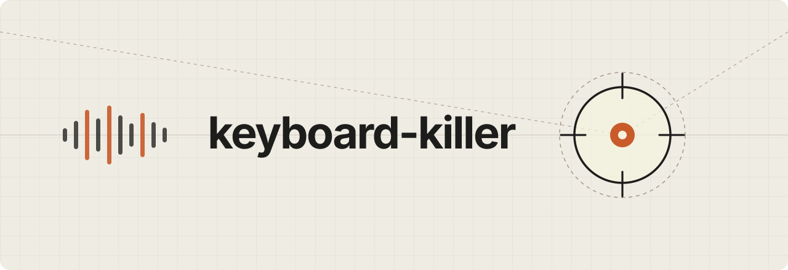

<p align="center">
  <a href="https://keyboard-killer.ohrats.party">
    
  </a>
</p>

<p align="center">
  <em>Local-first stereo gaze, acoustic pop-click, and low-latency voice control for the Linux desktop.</em>
</p>

<p align="center">
  <a href="https://keyboard-killer.ohrats.party">Website</a> ·
  <a href="https://keyboard-killer.ohrats.party/docs.html">Docs</a> ·
  <a href="docs/architecture.md">Architecture</a> ·
  <a href="docs/RELEASES.md">Releases</a>
</p>

Look at a target, say what you mean, and Keyboard-Killer does the rest. Stereo cameras, speech recognition (Parakeet TDT 0.6B v2 int8), and command history all stay on your machine.

## Install (Linux)

```sh
curl -fsSL https://keyboard-killer.ohrats.party/install.sh | sh
```

On Debian and Ubuntu, this verifies `SHA256SUMS` and installs the self-contained `.deb` via `apt` (including the `/dev/uinput` udev rule, desktop entry, and optional systemd user unit). On other Linux distributions, it installs the AppImage for your user.

Open **Keyboard-Killer** from your application menu — first run walks you through permissions, cameras, calibration, and the local speech model with no terminal or JSON editing required.

## CLI & Diagnostics

```sh
keyboard-killer doctor
keyboard-killer doctor --json
keyboard-killer models status
keyboard-killer run --dry-run
```

## Development

```sh
uv run python packaging/linux/build_deb.py --appimage
```

See [`docs/architecture.md`](docs/architecture.md) and [`docs/decisions.md`](docs/decisions.md) for architecture notes, benchmarks, and platform status.

## License

See [`LICENSE`](LICENSE).
